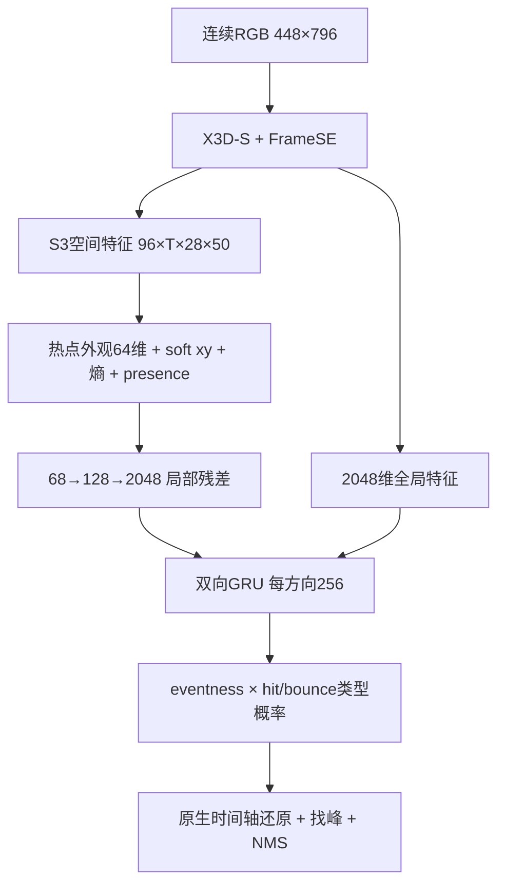

# TennisContactNet

仅使用 RGB 视频检测网球 **hit（击球）和 bounce（落地）**。提供已经训练好的最佳权重，以及独立的数据处理、训练、断点恢复、推理和事件评价代码。

本项目来自已完成的 EO 研究模型整理，使用新的项目与模型命名。网络约 **680 万参数**；原六来源开发验证集的事件 F1 为 **96.8919%**，采用 validation 选择的补充阈值时为 **97.0965%**。这些是历史正式评价结果，本次代码整理没有重新运行完整数据集。

## 安装

使用独立的 Conda 环境 `tennis-contact`，由 [environment.yml](environment.yml) 安装 Python 3.13、FFmpeg（包括 `ffprobe`）和项目依赖。

```bash
git clone https://github.com/ZSHYC/tennis-contact-rgb.git
cd tennis-contact-rgb
conda env create -f environment.yml
conda activate tennis-contact
tennis-contact --help
```

后续训练、推理、评价和测试均在该 Conda 环境中运行。新终端先执行 `conda activate tennis-contact`；不方便激活时可使用 `conda run -n tennis-contact tennis-contact --help`。项目不会自动下载其他模型；两份所需权重随仓库提供。

更新依赖：

```bash
conda env update -n tennis-contact -f environment.yml
```

## 直接检测自己的视频

在项目根目录运行：

```bash
tennis-contact predict --video /path/to/match.mp4 \
  --checkpoint weights/best.pt --device cuda --output runs/match.json
```

没有 GPU 时把 `--device cuda` 换成 `--device cpu`。CPU 线程数在子命令前指定，例如 `tennis-contact --threads 4 predict ...`。

输出 JSON 包含每个原生帧的真实 PTS、两类分数、经过找峰及 NMS 的事件，以及读取、前向和总耗时。`frame_number` 从 **0** 开始；`time_seconds` 相对视频第一帧。每个事件示例：

```json
{"frame_number": 123, "event_type": "bounce", "score": 0.91, "time_seconds": 4.1}
```

默认使用主阈值 `hit=0.60 / bounce=0.48`；`--profile secondary` 使用原 DEV 选择的 `0.67/0.57`。新数据需要调阈值时，在自己的 validation 上运行下文的 `evaluate --tune`，然后用 `predict --thresholds runs/validation.json` 应用结果。

## 数据处理

复制 [examples/dataset.json](examples/dataset.json)，逐视频明确写出路径、来源和 `train / validation / holdout` 切分。视频与标注路径相对输入清单所在目录。可内联事件，也可提供 CSV 或 LabelMe 标注目录：

```json
{
  "samples": [
    {
      "id": "match_001",
      "video": "video/match_001.mp4",
      "split": "train",
      "source": "my_dataset",
      "annotations": "GT/match_001.csv"
    },
    {
      "id": "match_002",
      "video": "video/match_002.mp4",
      "split": "validation",
      "source": "my_dataset",
      "events": [{"frame_number": 42, "event_type": "hit"}]
    }
  ]
}
```

CSV 为 `frame_number,event_type`，也支持已有数据的 `frame_number,label`。`near_hit / far_hit` 合并为 hit，`near_bounce / far_bounce` 合并为 bounce；net 标签不训练为第三类。CSV 和 LabelMe 文件名前导帧号默认从0开始，1-based 文件应明确写成：

```json
"annotations": {"path": "GT/match_001.csv", "frame_numbering": "one_based"}
```

```bash
tennis-contact prepare --input /path/to/dataset-input.json --output data/dataset.json
```

`prepare` 解析真实 PTS 和标注，生成一个可读 JSON 数据清单。它不导出图片、特征或轨迹，不创建图像缓存。训练和推理直接解码原视频，只在内存中完成缩放与 JPEG95 编解码，以保持已训练权重的输入分布。

支持 `.mp4/.mov`，扩展名大小写均可；拒绝可视化输出视频。每个视频只能属于一个 split，不随机拆分视频帧。数据按完整标注处理：没有事件的区间就是背景，缺失标签不能当作“部分标注”使用。

## 训练与恢复

`weights/initialization.pt` 是 EO 事件续训之前的成熟父模型，`weights/best.pt` 是已经完成续训的最佳 EO 权重。默认从父模型开始，只更新产生本轮 EO 的第二个残差阶段：

```bash
tennis-contact train --dataset data/dataset.json \
  --checkpoint weights/initialization.pt --output runs/train \
  --device cuda --epochs 1 --batch-size 4 --lr 0.000001 \
  --scope backbone2 --precision bf16
```

`batch-size` 表示梯度累积的窗口数，不把多个大视频窗口同时堆进显存；末批不足4个也会更新。`--scope all` 可训练全部网络参数，`--checkpoint weights/best.pt` 可从最佳权重继续适配；BatchNorm 的已有统计始终冻结。BF16 仅用于视觉骨干，局部状态、时间头和 loss 保持 FP32；`--precision fp32` 可关闭混合精度。

先做短训：

```bash
tennis-contact train --dataset data/dataset.json \
  --checkpoint weights/initialization.pt --output runs/train \
  --device cuda --max-steps 2
```

恢复命令、文件名与实际训练验证结果见 [训练说明](docs/训练说明.md)。数据读取改为直接原视频后，速度会与历史图像缓存路径不同。完整历史训练包含此前多轮父模型训练；本仓库交付父初始化和最终权重，并不声称一次短命令能从随机初始化重现全部历史成绩。

## 批量预测与评价

```bash
tennis-contact predict --dataset data/dataset.json --split validation \
  --checkpoint weights/best.pt --device cuda --output runs/validation-predictions

tennis-contact evaluate --dataset data/dataset.json --split validation \
  --predictions runs/validation-predictions --output runs/validation-primary.json

tennis-contact evaluate --dataset data/dataset.json --split validation \
  --predictions runs/validation-predictions --tune --output runs/validation.json
```

评价按类别找局部峰、同类 NMS 半径5帧，再按 **同类 ±5 原生帧一对一匹配**计算 TP/FP/FN、Precision、Recall、F1，并分别报告来源和类别。平顶峰取最左帧；匹配优先最大命中数，再最小时间误差。

阈值只能在 validation 选择。holdout 使用已经冻结的阈值，例如：

```bash
tennis-contact predict --dataset data/dataset.json --split holdout \
  --checkpoint weights/best.pt --thresholds runs/validation.json \
  --device cuda --output runs/holdout-predictions

tennis-contact evaluate --dataset data/dataset.json --split holdout \
  --predictions runs/holdout-predictions \
  --hit-threshold 0.67 --bounce-threshold 0.57 --output runs/holdout.json
```

最后一条中的两个数只是原 EO 补充工作点示例；自己的数据应填写 validation 实际选出的阈值。

## 网络与成绩



模型只输入 RGB。官方球点曾用于父模型训练辅助监督，不作为推理输入；本轮 EO 继续训练使用事件监督。不使用 DINO、B0、TrackNet 轨迹或检测分数。

| 六来源 DEV 工作点 | TP / FP / FN | F1 |
|---|---|---:|
| Primary，0.60/0.48 | 4380 / 163 / 118 | **96.8919%** |
| Secondary，0.67/0.57 | 4364 / 127 / 134 | **97.0965%** |

DEV 为505视频、197,117帧、4,498事件；E2E 占约81%的事件。Primary hit F1为97.5765%，bounce为96.1494%。自采/admin/back/E2E/Loveall/TrackNet 的 Primary F1 依次为 **91.3525% / 79.6875% / 87.1795% / 98.4490% / 74.8201% / 97.8142%**。

| 补充外部评价轴 | 视频数 | Primary F1 |
|---|---:|---:|
| 历史 holdout | 45 | 89.6592% |
| E2E | 1622 | 97.4490% |
| 历史 admin | 6 | 85.3945% |

完整计数与类别/来源结果在 [docs/results.json](docs/results.json)。DEV 长期参与研发，不是新盲测；不同外部轴也不能混成统一测试成绩。没有同协议父模型外部配对，因此只报告 EO 的外部绝对成绩。

## 文件结构

```text
src/tennis_contact/
  data.py         标注、PTS、视频读取和窗口采样
  model.py        TennisContactNet及权重加载
  training.py     训练目标、更新和恢复
  inference.py    逐窗预测与完整时间轴还原
  evaluation.py   找峰、NMS、一对一匹配和阈值选择
  cli.py          四个命令
weights/
  best.pt         最佳EO权重
  initialization.pt  事件续训之前的父权重
tests/            核心行为回归测试
```

```bash
pytest -q
```

它是使用双向时间信息的离线模型。局部热点不保证等于真实球位置；挥拍但未接触球、落地前提前响应以及跨来源差异仍是已知错误。独立整理的验证范围见 [docs/验证记录.md](docs/验证记录.md)。
