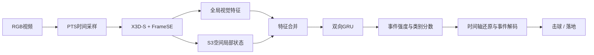

<div align="center">

# TennisContactNet

**从网球视频中定位击球与落地事件。**

<p>
  
  
  
</p>

[快速开始](#快速开始) · [预训练权重](#预训练权重) · [训练与评价](#训练与评价) · [文档](#文档)

</div>

TennisContactNet 是一个基于 RGB 视频的网球事件检测工具。输入比赛视频，输出 **hit（击球）** 和 **bounce（落地）** 的帧号、时间与置信分数，适用于视频标注辅助、比赛片段索引和离线数据分析。

仓库提供可直接使用的预训练权重，以及数据准备、模型训练、断点恢复、批量推理和事件级评价代码。

## 功能概览

| 能力 | 说明 |
| --- | --- |
| 单视频推理 | 读取 MP4 / MOV，生成事件列表与逐帧分数 |
| 批量处理 | 按数据清单和 split 处理视频，每个视频输出一个 JSON |
| 数据准备 | 解析真实时间戳，支持 CSV、LabelMe 和内联事件标注 |
| 模型训练 | 支持局部骨干微调、全参数训练、梯度累积和 BF16 |
| 断点恢复 | 保存模型、优化器、训练游标和随机数状态 |
| 事件评价 | 按类别与来源统计指标，在 validation 上选择阈值 |

模型约 **680 万参数**，采用 X3D-S、逐帧通道注意力、空间局部状态和双向 GRU。推理需要事件前后的画面，按离线方式运行。

## 快速开始

### 1. 创建 Conda 环境

推荐在 Linux 上使用。准备好 Conda；使用 GPU 时需要可用的 NVIDIA 驱动。

```bash
git clone https://github.com/ZSHYC/tennis-contact-rgb.git
cd tennis-contact-rgb

conda env create -f environment.yml
conda activate tennis-contact

tennis-contact --help
```

[environment.yml](environment.yml) 安装 Python 3.13、FFmpeg 和项目依赖。首次安装会下载 PyTorch 及相关运行库。后续命令均在项目根目录、激活该环境后执行。

### 2. 检测一段视频

```bash
tennis-contact predict \
  --video /path/to/match.mp4 \
  --checkpoint weights/best.pt \
  --device cuda \
  --output runs/match.json
```

使用 CPU 时，将 `--device cuda` 改为 `--device cpu`。

### 3. 查看检测结果

```bash
python -c 'import json; print(json.load(open("runs/match.json"))["events"])'
```

输出文件中的 `events` 字段示例：

```json
{
  "events": [
    {
      "frame_number": 123,
      "event_type": "bounce",
      "score": 0.91,
      "time_seconds": 4.1
    }
  ]
}
```

`frame_number` 从 **0** 开始，`time_seconds` 相对视频第一帧。完整 JSON 还包含原生帧时间戳、每帧两类分数、阈值及运行耗时。字段定义见 [推理与评价](docs/推理与评价.md)。

## 预训练权重

两份权重随仓库提供，均使用同一 `TennisContactNet` 结构。

| 文件 | 用途 |
| --- | --- |
| [weights/best.pt](weights/best.pt) | 视频推理，以及在自己的数据上继续微调 |
| [weights/initialization.pt](weights/initialization.pt) | 作为训练的初始化参数；`train` 默认加载此文件 |

权重中的阈值配置可通过 `predict --profile` 选择：

| 配置 | hit 阈值 | bounce 阈值 |
| --- | ---: | ---: |
| `primary`，默认 | 0.60 | 0.48 |
| `secondary` | 0.67 | 0.57 |

为自己的数据选择工作点时，使用 `evaluate --tune`，再通过 `predict --thresholds` 读取生成的评价文件。

## 训练与评价

### 准备数据清单

按照 [数据格式](docs/数据格式.md) 准备视频与标注，并参考 [examples/dataset.json](examples/dataset.json) 填写输入清单。视频需要明确划分为 `train`、`validation` 或 `holdout`。

```bash
tennis-contact prepare \
  --input data/dataset-input.json \
  --output data/dataset.json
```

`prepare` 将时间戳和规范化事件写入 JSON 清单；训练与推理按需读取原视频。视频和标注数据由使用者准备。

### 开始训练

```bash
tennis-contact train \
  --dataset data/dataset.json \
  --checkpoint weights/initialization.pt \
  --output runs/train \
  --device cuda \
  --epochs 1 \
  --batch-size 4 \
  --scope backbone2 \
  --precision bf16
```

`backbone2` 微调指定骨干阶段；`all` 开放全部网络参数，BatchNorm 统计保持冻结。`batch-size` 表示每次更新累积的窗口数。训练范围、损失函数与恢复操作见 [训练说明](docs/训练说明.md)。

训练目录包含：

```text
runs/train/
├── last.pt       # 用于推理或继续微调
└── training.pt   # 用于恢复当前训练
```

### 批量推理并选择阈值

```bash
tennis-contact predict \
  --dataset data/dataset.json \
  --split validation \
  --checkpoint weights/best.pt \
  --device cuda \
  --output runs/validation-predictions

tennis-contact evaluate \
  --dataset data/dataset.json \
  --split validation \
  --predictions runs/validation-predictions \
  --tune \
  --output runs/validation.json
```

评价报告包含总体、击球、落地和各数据来源的 TP / FP / FN、Precision、Recall 与 F1。事件匹配采用同类别 **±5 原生帧**的一对一匹配。`--tune` 只允许用于 validation；holdout 使用已确定的阈值。完整流程见 [推理与评价](docs/推理与评价.md)。

## 模型结构



网络在固定物理时间间隔上组织上下文，将全局场景特征与局部视觉状态结合，再判断事件类别和发生时刻。详细维度与分数计算见 [模型结构](docs/模型结构.md)。

## 文档

| 文档 | 内容 |
| --- | --- |
| [数据格式](docs/数据格式.md) | 目录组织、CSV、LabelMe、帧号和数据划分 |
| [训练说明](docs/训练说明.md) | 训练参数、微调范围、断点恢复和自定义请求顺序 |
| [推理与评价](docs/推理与评价.md) | 批量预测、JSON 字段、阈值选择和 holdout 评价 |
| [模型结构](docs/模型结构.md) | 输入采样、视觉骨干、空间状态和时间建模 |
| [开发与测试](docs/开发与测试.md) | 代码结构、测试覆盖和环境自检 |

## 常见问题

**可以实时处理视频流吗？**

当前模型使用双向时序信息，面向完整视频的离线检测。

**模型会输出球坐标或轨迹吗？**

命令行输出事件类别、帧号、时间和分数。网络内部的空间注意力用于事件判断，不提供经过球定位评价的坐标输出。

**CPU 能运行吗？**

可以，训练和推理都支持 `--device cpu`。CPU 上建议训练时同时指定 `--precision fp32`；运行速度取决于视频长度和硬件。

**为什么减小 batch-size 后，单窗口显存仍较高？**

训练依次处理视频窗口并累积梯度。`batch-size` 控制一次参数更新累积多少个窗口，单窗口峰值主要由输入分辨率和上下文长度决定。

**找不到 ffprobe 或命令行入口怎么办？**

先执行 `conda activate tennis-contact`。环境由其他位置创建后，进入当前仓库执行 `python -m pip install -e '.[dev]'`，以注册当前代码的命令行入口。

## 开发

```bash
conda activate tennis-contact
pytest -q
```

问题反馈请附上运行命令、环境版本、错误信息和可复现的输入说明：[提交 Issue](https://github.com/ZSHYC/tennis-contact-rgb/issues)。
